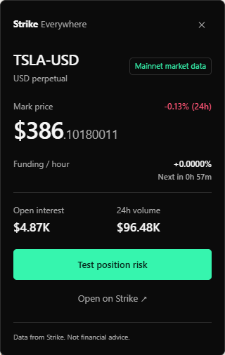

<p align="center">
  
</p>

<h1 align="center">Strike Everywhere</h1>

<p align="center">
  <strong>Markets, in context.</strong><br>
  A Chrome MV3 extension that turns tickers on the page you are reading into live Strike market cards, then tests a virtual position against 30 days of mark-price history.
</p>

<p align="center">
  <a href="https://github.com/everythingcode-1/strike-everywhere">Repository</a> ·
  <a href="video-motion/out/strike-everywhere-demo.mp4">Demo video</a> ·
  <a href="docs/submission.md">Submission notes</a> ·
  <a href="docs/verification/">Verification</a>
</p>

> **Experimental build.** This build uses public mainnet market data. Ghost Trades are virtual ledger records, not exchange positions. Risk numbers are experimental estimates and have not been validated against three real Strike positions. A replay is historical scenario evidence, not a forecast or a safety recommendation.

**No wallet. No orders. No account data. No telemetry.**

<p align="center">
  
</p>

## What it does

Strike Everywhere keeps the sentence and the market in one place. A listed ticker becomes a card; a selected claim becomes a testable scenario; the result becomes a receipt you can inspect later.

| | |
|---|---|
| **Product** | Chrome MV3 extension for contextual Strike market data |
| **Core loop** | Ticker card → claim capture → virtual trade → receipt |
| **Risk evidence** | 43,200 one-minute mark candles for a 30-day replay |
| **AI analysis** | Optional Jev via TypeSafe or OpenRouter, BYOK |
| **Safety** | No wallet, no orders, no account data, no telemetry |
| **Status** | Mainnet public data; experimental estimates; see [Known limitations](#known-limitations) |

## Quick start

### Build and load

```bash
git clone https://github.com/everythingcode-1/strike-everywhere.git
cd strike-everywhere
npm install
npm run build
```

1. Open `chrome://extensions`, enable **Developer mode**, click **Load unpacked**, and choose `dist/`.
2. Run `npm run demo` and open <http://localhost:4173/article.html>.
3. Open the side panel from the toolbar. Enable **Detect on all sites** or toggle **localhost** for this site.
4. Hover `$BTC`, `$ETH`, or a listed equity ticker such as `TSLA`. Press `Enter` to pin the card; `Esc` closes it.
5. Select a sentence, right-click, and choose **Analyze with Strike Everywhere**. Review the claim, then use **Review simulation** → **Create virtual trade**.
6. Open **Ghost Trades** to refresh the mark or close virtually. **Receipts** exports the local record as JSON.

### Development

```bash
npm run dev        # Vite watch build; reload the unpacked extension from dist/
npm run typecheck  # tsc --noEmit
npm run test       # Vitest
npm run test:watch # Vitest watch mode
```

## How it works

| Step | What happens |
|---|---|
| **1. Detect** | Scans text nodes for verified Strike symbols. Uppercase 2–12 character base assets (letters first, digits allowed) are word-bounded; ambiguous tokens need `$`; code, inputs, URLs, and the first `h1` are skipped. A debounced mutation scan caps at 40 highlights. |
| **2. Inspect** | Hover or keyboard opens a 320 px card in a closed Shadow DOM. It shows mark price, 24-hour change, funding, open interest, volume, and a stress test. |
| **3. Test** | Choosing **Analyze with Strike Everywhere** opens the side panel. Choose a verified market and direction, then replay the position against 43,200 one-minute mark candles. |
| **4. Record** | Create a virtual Ghost Trade from a fresh book, refresh or close it, and export a receipt with the claim, fills, costs, policies, and unknowns. |

## Features

| Area | What it does |
|---|---|
| **Market card** | Live price, 24-hour change, funding, open interest, volume, spread, basis, average daily range, and an hourly sparkline. Five states: `loading`, `ready`, `offline-cached`, `not-tradable`, `error`; falls back to the last snapshot from IndexedDB when offline. |
| **Simulator** | Liquidation price, initial margin, taker fee, funding per day, and leverage capped to the market tier. |
| **Slippage** | Depth-based VWAP for the entered size; partial-fill warning; slipped entry used in the replay. |
| **30-day replay** | Exactly 43,200 consecutive completed one-minute **mark-price** candles. Entry fees, constant-rate hourly funding, staged reductions, and adverse price excursion through the first liquidation. |
| **Ghost Trades** | A locally stored virtual perpetual with a fresh mark/book, full-fill market entry, stepped quantity, entry and exit fees, virtual close, and an immutable entry and claim snapshot. |
| **Receipts** | Local viewer and JSON download with the claim, original decision, entry fill and evidence, costs, policies, unknowns, events, and monitoring gaps. |
| **Jev analysis** | Optional classification through TypeSafe or OpenRouter. Structured enum answers, consent-gated, manual fallback. |
| **Strike app** | Reads order-ticket values only on **Simulate** or **Refresh**; supports a hypothetical single cross-margin position; rejects isolated margin. |
| **Watchlist** | Top movers by 24-hour change and funding extremes from all-symbol tickers. |
| **Claim capture** | Selection-only context menu; sanitized http(s) source; 4,000-character limit; form-field selections refused; side panel opens on the user gesture. |
| **Side panel** | Discover, Markets, Ghost Trades, Receipts, and Settings; the toolbar icon opens it. |
| **Per-site control** | Global switch, all-sites switch, and per-domain override persisted in `chrome.storage.local`. |
| **Privacy** | No wallet, no order endpoint, no analytics, no remote code, no telemetry. |

## Jev setup

Jev is optional. Manual Ghost Trades work without a key.

1. Open **Settings** in the side panel.
2. Choose **TypeSafe** or **OpenRouter**.
3. Paste the matching key and save. OpenRouter defaults to `jev-latest`; change the model ID only if you need a specific Jev or chat model.
4. Select a claim, tick the consent box, and press **Analyze**.

- **TypeSafe:** official `@typesafe-ai/sdk` against `https://api.typesafe.ai`.
- **OpenRouter:** the same SDK against `https://openrouter.ai/api`. Jev model IDs use System One (`/api/v1/systemone`) with typed questions; explicit chat models use `/api/v1/chat/completions` and are not Jev.
- **Storage:** the key is saved in `chrome.storage.local` with trusted-context access. It is not returned to the panel, written to a receipt, or logged. Clear it in **Settings**.
- **Migration:** if you previously saved a chat model, set the model ID to `jev-latest` and save again to use Jev.
- **Evidence:** live OpenRouter Jev calls were verified on 2026-10-23 with Jev 1.14 and 1.13. The direct TypeSafe path has not been live-verified; its SDK boundary and structured parser are unit-tested.

## Verification

```bash
npm run typecheck
npm run test
npm run build
```

| Check | Result | Evidence |
|---|---|---|
| TypeScript | Pass | `npm run typecheck`, exit 0 |
| Unit and message-integration tests | **150 passed across 22 files** | `npm run test`, exit 0 |
| Production bundle | Pass | `npm run build`, exit 0 |
| Mainnet market data | 32 listed symbols; BTC and TSLA cards; BTC completed a 43,200-candle replay; TSLA's replay was refused because one API candle had an open above its high | [Mainnet report](docs/verification/mainnet.md) |
| Live Jev via OpenRouter | Jev 1.14 and 1.13 returned schema-valid classifications | [Report](docs/verification/jev-openrouter.md), [1.14 evidence](docs/verification/jev-openrouter-1.14-live.json), [1.13 evidence](docs/verification/jev-openrouter-live.json) |
| Browser and unpacked checks | Recorded with limitations | [Verification record](docs/verification/2026-10-22.md), [Ghost report](docs/verification/ghost-trading.md), [UI report](docs/verification/ui-redesign.md) |
| Position-level ground truth | **Not met** | [Known limitations](#known-limitations) |

Formula fixtures are regression examples, not API ground truth. Tests cover margin and liquidation, replay completeness, slippage, detector false positives, Ghost accounting and lifecycle, privileged-message validation, and Jev response parsing.

## Known limitations

### Ground truth and data

- **No position-level API ground truth.** A request to `/v2/positions` without an account selector returned 401. That response does not prove selected public-address queries require authentication. Three real positions have not been compared; `tests/fixtures/positions.json` contains algebraic regression cases. The UI is labeled experimental while this acceptance gate remains unmet.
- The server gap-fills missing candles with the previous close and zero volume, which **understates volatility**. A flat or gap-filled history may still pass continuity validation.
- Funding during replay uses the current hourly rate, not historical funding.
- Equity symbols are mainnet-only. Base assets longer than 12 characters are never detected; the current registry's longest is 7 (`SKHYNIX`, `UNITREE`).

### Replay and simulator

- Replay uses the current mark notional's tier and charges entry and reduction taker fees. It can attempt only one reduction per minute, at that candle's adverse extreme. Intraminute ordering, liquidation penalties, fee discounts, and other positions in a cross-margin wallet are not modeled.
- An uncached replay fetches 29 pages in batches of six. The same completed-minute window is reusable; a newer minute requires a fresh window. Incomplete, stale, or malformed history produces an error with no verdict.
- Slippage estimates use a 5-second depth cache and can be noisy on thin markets. Partial fills are labeled.
- Isolated margin is unsupported and rejected with an explanation.
- Replay preserves historical percentage moves from today's mark and a separate execution entry; it does not reproduce an actual historical account.

### Ghost Trades

- Ghost Trades are virtual and local. Funding is unknown and excluded from net; liquidation is unavailable; SL/TP, limit, and partial-fill Ghost orders are not implemented.
- Monitoring happens on panel boot and manual **Refresh** only. Browser closure is not claimed as continuous monitoring; a direct virtual close records an unobserved gap when the threshold is exceeded.
- A position larger than the market's current per-order maximum cannot be closed as a single virtual market order; the close is refused with a clear error rather than split silently.
- Receipts are export-only. Import, sharing, and backend sync are not implemented.

### AI analysis

- Live Jev verification used OpenRouter on 2026-10-23 (Jev 1.14 and 1.13). The direct TypeSafe path has not been live-verified. Missing or invalid key, timeout, rate limit, and malformed response fall back to the manual flow.
- The Jev key is stored **unencrypted** in `chrome.storage.local`, restricted to trusted extension contexts. The extension does not encrypt it at rest; clear it in **Settings** when done.
- TypeSafe and OpenRouter are optional host permissions. If permission is denied, Jev stays off and manual Ghost Trades still work.

### Capture and UI

- Content scripts match `http(s)` only. Opening `demo/article.html` from `file://` requires enabling file access and adding `file:///*` to the manifest; use `npm run demo` instead.
- `not-tradable` is only reachable if the registry and the markets endpoint disagree; every symbol in the bundled registry is currently tradable.
- Auto-read on the Strike app is selector-based and can break when the app's DOM changes. If size, leverage, or side cannot be read, the panel asks for manual input; it reads on **Simulate**/**Refresh** only.
- The context-menu capture path is covered by permission checks, URL sanitation tests, and a seeded claim in the extension UI. A real native right-click was not automated in headless Chrome; verify it manually in a clean profile.
- The stored claim keeps the page path but strips query, fragment, and credentials. The panel and receipt display the source domain, not the full path.
- The side-panel watchlist refreshes every 30 seconds or on **Refresh**.

## Privacy and safety

- News-page content scripts read only the text nodes they scan. The Strike app simulator reads order-ticket values (size, leverage, side, margin mode) only when the user clicks **Simulate** or **Refresh**; it never reads cookies, `localStorage`, or account data, and never logs page text or URLs.
- The selection context menu is created for `selection` only and refuses editable form fields. Claim text leaves the browser only after the user ticks the provider disclosure and presses **Analyze with Jev**. Source URL query, fragment, account data, balances, and receipts are not sent.
- The Jev key is held in `chrome.storage.local` with trusted-context access. It is never returned to the panel, written to the ledger or receipt, or logged. It stays on this device until you clear it.
- Content scripts cannot call privileged claim, Ghost, or Jev messages: the worker checks the sender's extension origin, and key messages are restricted to trusted extension pages.
- Network access is limited to the two Strike API hosts in `host_permissions` plus the optional `https://api.typesafe.ai/*` and `https://openrouter.ai/*` hosts requested only for Jev.
- No remote code, fonts, analytics, crash reporting, or order endpoints.
- Every card ends with: *Data from Strike. Not financial advice.*

## Layout

```text
src/shared/      types, constants, v2 message/result types, Ghost contracts
src/lib/         api, cache, symbols, detector, slippage, market extras, watchlist, ticket reader
src/risk/        pure margin and replay engine
src/ghost/       pure accounting/fills/rules/resolver/lifecycle, ledger store, orchestration
src/jev/         TypeSafe/OpenRouter client, structured questions/parser, local key storage
src/content/     detector wiring, hover card, Strike app simulator, shadow-DOM UI
src/background/  message router, context menu, caching, replay and Ghost orchestration
src/popup/       side-panel Discover, Markets, Ghost, Receipts, and Settings views
tests/           margin, replay, detector, slippage, market extras, watchlist, ticket reader, Ghost, Jev, fixtures
demo/            local article fixture and static server
docs/            verification records, submission notes, demo script
landing/         Next.js product site
video-motion/    Remotion demo source and rendered MP4
```

## License

MIT. See [LICENSE](LICENSE).

---

Repository: [everythingcode-1/strike-everywhere](https://github.com/everythingcode-1/strike-everywhere) · Demo: [strike-everywhere-demo.mp4](video-motion/out/strike-everywhere-demo.mp4) · Verification: [docs/verification](docs/verification/)
